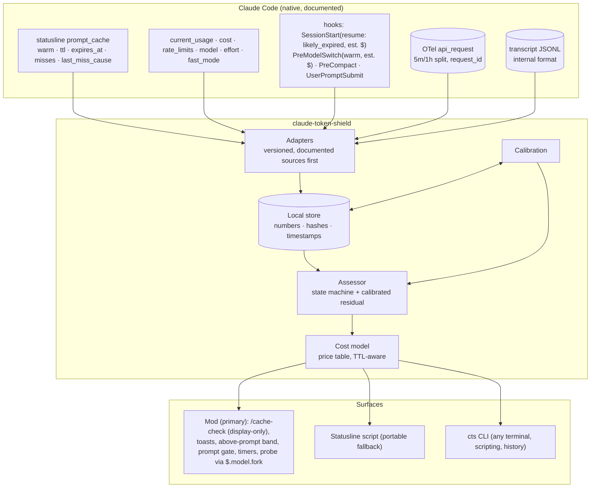

# Cache Awareness for Claude Code — Design

Status: draft · Builds on: [cache-feature-spec.md](cache-feature-spec.md), [cache-check-command.md](cache-check-command.md), [cache-monitor-design.md](cache-monitor-design.md), [cache-confidence-engine.md](cache-confidence-engine.md). [cache-research.md](cache-research.md) is empty; §1 and §2 stand in for it.

Audience: power users running 100k–1M+ token Claude Code sessions who want to avoid surprise cache rebuilds.

Research basis (2026-11-25):

- Claude Code docs: `prompt-caching`, `statusline`, `hooks`, `monitoring-usage`, `costs` (code.claude.com/docs)
- Anthropic API prompt-caching reference
- The mod (plugin hooks-module) API types shipped with Claude Code 2.1.332
- The structure of Claude Code transcript files (field names and record shapes, not their content)

---

## 0. Headline findings

1. **Claude Code already computes most of what the original proposal wanted to infer.** Since v2.1.251 the statusline receives a documented `prompt_cache` object:
   - `warm`, `ttl`, `expires_at`
   - `misses`, `expected_rebuilds`, `hit_ratio`
   - `recache_tokens_if_cold`
   - `last_miss_cause` and `miss_causes` (v2.1.260+)

   The statusline **re-renders by itself when a warm cache reaches `expires_at`**. `/usage` shows a `Prompt cache (main)` line. `/model` and effort changes **ask for confirmation while the cache is warm**. The `SessionStart` (resume/fork) and `PreModelSwitch` hooks carry `prompt_cache_likely_expired` / `prompt_cache_warm`, `context_tokens`, and `estimated_cache_write_usd`.

   **The project should be a thin layer over these native signals, not a parallel inference engine.** It adds what is missing: forward-looking pricing in the moment, a pre-submit gate, transition notices, cross-session history, calibration, and an on-demand probe.

2. **Cache state is a step function, not a decay.** An entry is fully usable until its TTL, then gone: requests inside the TTL are expected to read the cache almost always, and requests past it almost never. A 0–100 "health" that slides from WARM through COOLING to RISKY describes nothing real, so it is replaced by evidence-based states plus a probability only where something is genuinely uncertain.

3. **Most "change detectors" in the original proposal would produce false alarms.** Per the docs:
   - Editing MCP config does not change the cache until restart.
   - Editing CLAUDE.md mid-session keeps the cache (read at session start).
   - With tool search (the default on supported models), MCP servers connecting or disconnecting mid-session do not disturb the cache.
   - Plugin skills, commands, agents, and hooks are appended.
   - Upgrades apply on next launch.

   Alarms are raised only for documented invalidators: model switch (including fallback and `opusplan`), effort change on models without per-message effort, fast-mode toggle, tool-definition changes when tools load upfront, compaction, image-batch removal, and session start after an upgrade.

4. **The TTL is not a constant, and it can change mid-session.**
   - Main thread: 1 h on a subscription within plan usage; **5 m on API key, cloud providers, or once a subscription draws on usage credits**.
   - Subagents: 5 m by default.
   - Settings and environment variables override both.

   Always take the TTL from the latest request, never from configuration or an assumption.

5. **Most within-TTL misses should be attributable.** The documented causes (compaction, system or tool changes, model, effort or parameter changes) are the ones Claude Code's own `last_miss_cause` names. Whatever remains unexplained is the honest residual ε, measured from each user's own history.

6. **A probe must replay the exact prefix, so on a miss it costs as much as the miss.** The mod API provides exactly this primitive: `$.model.fork` re-sends the main thread's last request (same model, system, tools, messages) plus one short prompt, using Claude Code's own credentials. The original "tiny request" and "deep probe" ideas measure the wrong cache entry, or only measure the probe's own write, and are dropped.

7. **The check itself must not touch the conversation.** The mod API lets a slash command answer with `isTextDisplayOnly: true` (drawn for the person, sent in no request). It also offers toasts, display-only placed rows, and an above-prompt band that leave the transcript and model untouched. A plain custom command, a skill, or `!` shell mode all enter the context.

8. **Only the first request of the next turn is exposed to a cold cache.** Later requests in a turn start seconds apart. The headline cost covers that one request. Output size and tool-loop length cannot be predicted and stay out of it.

---

## 1. Ground truth

### 1.1 API rules (Anthropic prompt-caching reference)

| Rule | Design consequence |
|---|---|
| Exact **prefix match**; render order `tools → system → messages`; any byte change invalidates everything after it | Reason in segments; a change's position decides how much is lost |
| TTL is 5 m or 1 h. A read refreshes the timer for free. Lifetime runs from the **start** of the request that wrote or read the entry. | Expiry is `last_touch_start + ttl`. Generation time counts against the TTL. |
| Caches are **model-scoped** and **speed-scoped** (fast mode has its own cache), isolated per workspace (Claude API) or per org (Bedrock, Vertex) | A model switch, speed toggle, or account switch leaves nothing to read |
| A breakpoint looks back **≤ 20 positions** | A very long single turn can miss inside the TTL |
| An entry is readable only once the first response **starts streaming** | Parallel subagents each write their own entries, which is expected |
| Caching is **best-effort** | There is a residual ε > 0, estimated from data |
| Pricing: write 1.25× (5 m) / 2× (1 h); read ~0.1× (0.05× Opus 5.5 / Sonnet 5.5; 0.025× Fable 5.1 / 5.2) | The miss penalty depends on model and TTL. Use a versioned price table. |

### 1.2 Claude Code behavior (code.claude.com/docs/en/prompt-caching)

| Topic | Documented behavior |
|---|---|
| Layers | System prompt (with tool definitions) → project context (CLAUDE.md, memory, rules) → conversation |
| TTL defaults | Main conversation: **1 h** on subscription within plan, **5 m** on API key / usage credits / cloud provider. Everything else (subagents, workflows, compaction, titles): 5 m, except server-controlled helpers on subscription. |
| TTL controls | `promptCacheTtl` / `CLAUDE_CODE_PROMPT_CACHE_TTL` (main), `subagentPromptCacheTtl` / `CLAUDE_CODE_SUBAGENT_PROMPT_CACHE_TTL`, subagent `cacheTtl` frontmatter, `ENABLE_PROMPT_CACHING_1H`, `FORCE_PROMPT_CACHING_5M` (highest precedence) |
| Invalidates | Model switch (`/model`, automatic fallback, `opusplan` toggles, a skill whose `model` differs); effort change on most models (**kept** on Fable 5.1+, Opus 5.5, Sonnet 5.5, Haiku 5.5 with API key or subscription); fast-mode toggle (including automatic fallback to standard speed); tool-definition changes when tools load upfront; enabling/disabling MCP-providing plugins; bare-tool deny rules without tool search; compaction (conversation and project context rebuilt); image-batch removal; the first conversation after an upgrade |
| Keeps | Editing repo files; editing CLAUDE.md mid-session; permission-mode changes; output-style changes; skills and commands (appended); `/recap`; `/rewind` (hits an earlier entry); spawning subagents; MCP connect/disconnect with tool search on; MCP config edits (applied only at restart) |
| Resume | Keeps the original system prompt; reads whatever prefix is unchanged and within TTL |
| Idle compaction | On the 1 h TTL, Claude Code can compact an idle long conversation (`idleCompaction: false` disables it) |
| Scope | Effectively per machine and directory. Parallel sessions in the same directory can share prefixes. |
| Disable | `DISABLE_PROMPT_CACHING` and per-family variants |

---

## 2. Certainty taxonomy

Every figure carries one tier.

| Tier | Definition | Can be wrong when… | Tag |
|---|---|---|---|
| **Measured** | Read directly from an API usage record, a recorded request, a hook/statusline field that reports a past fact, or a probe response. Always about the **past**. | Source corrupt or misparsed | `[measured]` |
| **Inferred** | Derived from measured facts plus documented rules. Deterministic. **This includes Claude Code's own `warm`, `expires_at`, and `last_miss_cause`**, which Claude Code computes the same way. | Rules changed, observation incomplete, undocumented semantics shifted | `[inferred]` |
| **Speculative** | Depends on unobservable server state or future user behavior. Shown only as a calibrated probability with an interval. | Always possible. Quality is tracked by calibration (§6.6). | `[estimated]` |

Rule zero: **nothing about the next request is measured.** The only measurement of current state is a probe, and a probe changes that state (it refreshes the entry).

| Quantity | Tier | Best source (documented first) |
|---|---|---|
| Last request's read / write (5 m vs 1 h) / uncached / output tokens | Measured | statusline `context_window.current_usage`; OTel `claude_code.api_request` (`cache_creation_5m_tokens` / `_1h_tokens`); mod `turn.step` usage; transcript |
| TTL in effect | Measured | `prompt_cache.ttl`; mod step `cacheTtl`; usage 5 m/1 h split |
| Session hit ratio, miss count, expected rebuilds, re-cached tokens | Measured (counts) | `prompt_cache.*` |
| Cause of a past miss | Inferred (by Claude Code); `likely_server_side` is speculative | `prompt_cache.last_miss_cause`, `miss_causes` |
| Warm now, expiry time | Inferred | `prompt_cache.warm`, `expires_at` |
| Tokens re-cached if cold | Inferred (exact size, uncertain outcome) | `prompt_cache.recache_tokens_if_cold`; hook `context_tokens` |
| $ to re-cache on model switch / cold resume | Inferred (list price or managed `modelPricing`) | `PreModelSwitch` / `SessionStart` `estimated_cache_write_usd` |
| Model, effort, fast mode, thinking, version | Measured | statusline `model`, `effort.level`, `fast_mode`, `thinking.enabled`, `version` |
| A model switch / speed toggle / compaction **is about to** invalidate | Inferred, very high confidence | `PreModelSwitch` hook; mod events; documented rules |
| Hit chance inside TTL, no pending events | Speculative (≈ 1 − ε, ε learned) | calibration store |
| Hit chance near the expiry boundary | Speculative | boundary model |
| Next turn's new input, output, tool loops | Speculative; **excluded from headline numbers** | — |
| Subscription plan impact | Partly measured: `rate_limits.*.used_percentage`. Per-turn impact is not observable. | statusline `rate_limits` |
| Server eviction, routing, load | Not observable | folded into ε |

---

## 3. Architecture

### 3.1 Layering



### 3.2 Delivery surfaces

| Surface | Strengths | Limits | Role |
|---|---|---|---|
| **Mod** (`.claude-plugin/plugin.json` + `hooks/register.tsx`) | Real local slash command (`command.run` → `{ text, isTextDisplayOnly: true }`); `$.ui.toast`, `$.ui.status`, above-prompt band, display-only `$.ui.place` rows; `prompt.submit` can drop a prompt with a reason shown only to the user; `$.clock` timers; `turn.step` usage with `at` + `cacheTtl`; `$.session.usage()`; `$.model.fork` for an exact-prefix probe; `$.store` across sessions | The mod API ships with the engine and is versioned with it. Its stability guarantees need confirming before depending on it. Hot-loading needs the person's consent. | **Primary UX** |
| **Statusline script** | Documented, stable JSON (`prompt_cache`, `current_usage`, `rate_limits`); re-renders at `expires_at` | One line; no interaction; no gate | Portable fallback, and the canonical source of native fields |
| **Hooks** (settings) | `UserPromptSubmit` can block (exit 2 / `decision: "block"`); `PreModelSwitch` can require confirmation; `SessionStart` resume carries cost estimates | Plain stdout on `UserPromptSubmit` / `SessionStart` / `PostModelSwitch` is **injected into context**, so never print there. Whether `systemMessage` stays out of context is not documented. | Gate and event capture where mods are unavailable |
| **`cts` CLI** | Works from any terminal; JSON output; history and calibration reports | Outside the session view | History, scripting, debugging |

### 3.3 Process model

- **No daemon.** The mod runs inside Claude Code. The statusline script and CLI are short-lived. All share one local store (`~/.claude-token-shield/`). It holds counts, timestamps, model IDs, cause names, and hashes, never prompt or response content.
- **Statusline budget:** p95 < 50 ms. No network. Transcript reads are incremental from a byte cursor, and only to backfill history.
- **Time display:** wall-clock expiry ("warm until 16:40"). The native statusline re-renders at `expires_at`, and the mod can use `$.clock`, so countdowns are used only where a timer is known to drive them.

---

## 4. Data model

```jsonc
// NativeSnapshot: verbatim copy of documented fields at each statusline/mod update
{ "ts": 1764085202, "session_id": "uuid", "cc_version": "2.1.332",
  "model": "claude-opus-5-5", "effort": "medium", "fast_mode": false,
  "prompt_cache": { "warm": true, "caching_observed": true, "ttl": "1h", "expires_at": 1764088802,
                    "requests": 214, "misses": 1, "expected_rebuilds": 1, "hit_ratio": 0.972,
                    "recache_tokens_if_cold": 812470,
                    "last_miss_cause": { "causes": ["tools_changed"], "tools_added": 1 } },
  "current_usage": { "input_tokens": 3, "cache_read_input_tokens": 798400,
                     "cache_creation_input_tokens": 11950, "output_tokens": 2204 },
  "rate_limits": { "five_hour": { "used_percentage": 41, "resets_at": 1764094000 } } }

// ApiRequest: one per main-thread or subagent request (from turn.step / OTel / transcript)
{ "request_id": "req_…", "session_id": "uuid", "lane": "main | subagent | compact | other",
  "ts_start": 1764085202.114, "ts_start_tier": "measured | inferred",
  "model": "…", "speed": "standard | fast", "effort": "…", "ttl": "1h | 5m | none",
  "usage": { "input": 3, "read": 798400, "write_5m": 0, "write_1h": 11950, "output": 2204 },
  "outcome": "HIT | PARTIAL | MISS | COLD_START | EXPECTED_REBUILD",
  "cause": ["tools_changed"], "cause_source": "claude-code | shield | none" }

// EnvEvent: something that changes (or might change) the next request
{ "ts": …, "session_id": "uuid",
  "kind": "MODEL_SWITCH | EFFORT_CHANGE | SPEED_TOGGLE | COMPACT | CLEAR | RESUME | TOOLS_CHANGED |
           PLUGIN_RELOAD | IMAGE_BATCH_DROP | TTL_CHANGED | ACCOUNT_CHANGE | VERSION_CHANGE",
  "impact": "WILL_INVALIDATE | MAY_INVALIDATE | NO_EFFECT",
  "basis": "documented-rule | measured | learned", "detail": { "from": "…", "to": "…" } }

// Assessment: what the surfaces render; stored for calibration
{ "ts": …, "state": "HOT | EXPIRING | UNCERTAIN | INVALIDATED | COLD | UNKNOWN",
  "p_hit": 0.993, "interval": [0.985, 0.997], "confidence": "HIGH | MEDIUM | LOW",
  "drivers": [{ "rule": "within_ttl", "tier": "inferred" }],
  "expires_at": …, "next_turn": { "prefix_tokens": 812470, "cost_hit": 0.17, "cost_miss": 6.50,
  "unit": "USD (API-equivalent)", "price_table": "2026-11-03" } }

// ProbeResult and CalibrationRecord
{ "ts": …, "usage": { … }, "outcome": "HIT | MISS | PARTIAL", "cost": 0.18, "refreshed_until": … }
{ "assessment_ts": …, "p_hit": 0.993, "state": "HOT", "actual": "HIT", "gap_s": 1834 }
```

---

## 5. States

| State | Condition | Message to the user | Replaces |
|---|---|---|---|
| **HOT** | `warm = true`, `now < expires_at − warn_window`, no pending WILL/MAY event | Sending now will almost certainly read the cache | HOT, WARM |
| **EXPIRING** | `warm = true`, inside `warn_window` (default 10 min for 1 h, 1 min for 5 m) | Still a hit if sent before HH:MM | COOLING |
| **UNCERTAIN** | Inside the boundary band around `expires_at`, **or** a MAY event pending (effort change where per-message effort is unconfirmed, a learned-risk event), **or** inputs partial or stale | A real coin flip. The only state where a probe is worth its price. | RISKY |
| **INVALIDATED** | A WILL event since the last request (model/speed switch, upfront tool change, compaction, TTL bucket change with an expired entry) | A rebuild is expected regardless of time | part of STALE |
| **COLD** | `warm = false` with `caching_observed = true`, or `now > expires_at + margin` | A rebuild is near-certain | STALE |
| **UNKNOWN** | No response yet (`prompt_cache` absent), `caching_observed = false`, or an unsupported version | We don't know, and why | — |

Two separate quantities replace the single "health %":

- **P(hit)**: a likelihood, with an interval.
- **Expected reuse**: the share of prefix tokens expected to be read rather than rebuilt (for example, after compaction the system layer is still cached). This is an amount, not a probability. Conflating the two is what made "Health: 47%" meaningless.

---

## 6. Confidence algorithm

### 6.1 Inputs

- The latest `NativeSnapshot`: authoritative for `warm`, `ttl`, `expires_at`, and `recache_tokens_if_cold`.
- The last main-thread `ApiRequest`: its start time, needed to check `expires_at` independently.
- Pending `EnvEvent`s since that request.
- Calibration parameters: `ε_within`, `ε_after`, `p_event[kind]`, the boundary fit.

### 6.2 Timing

```
expires   = prompt_cache.expires_at  ?? (last.ts_start + ttl)          # prefer native
skew      = 5 s                                                         # local clock vs server
t_err     = 2 s if expiry is native or ts_start measured, else last.generation_time
margin    = skew + t_err + 10 s
remaining = expires − now
```

If native `expires_at` and our own `ts_start + ttl` disagree by more than `margin`, record a **drift** event and drop confidence to MEDIUM. One of the two has the wrong start time.

### 6.3 Rules (deterministic, inferred)

```
if prompt_cache absent or caching_observed == false      → UNKNOWN
if any pending event.impact == WILL_INVALIDATE            → INVALIDATED, p_hit = ε_after (COMPACT shows as "expected rebuild")
```

| Event | Impact | Basis |
|---|---|---|
| Model switch (including fallback, `opusplan` toggle, a skill whose model differs) | WILL | documented |
| Fast-mode toggle (including automatic fallback to standard speed) | WILL | documented |
| Effort change, model **without** per-message effort | WILL | documented |
| Effort change, model with per-message effort (Fable 5.1+, Opus 5.5, Sonnet 5.5, Haiku 5.5; API key or subscription) | NO_EFFECT; on Bedrock, Vertex, gateways, or with `CLAUDE_CODE_DISABLE_EXPERIMENTAL_BETAS`, WILL | documented |
| Tool definitions changed with tools loaded upfront | WILL | documented |
| MCP connect/disconnect with tool search on; MCP config edit; CLAUDE.md edit; plugin skills/commands/hooks | NO_EFFECT | documented. **Never alarm on these.** |
| `/reload-plugins` with an MCP-providing plugin | WILL (Claude Code also warns) | documented |
| Compaction (manual, auto, idle) | WILL, as an expected rebuild of the conversation + project context | documented |
| Image-batch removal | WILL from the oldest removed image onward | documented |
| Subscription crosses into usage credits | TTL changes 1 h → 5 m for later writes. The current entry keeps its TTL. | documented |
| Long single turn > 20 non-collapsed positions | MAY | API rule; learned |

### 6.4 Time component (speculative, calibrated)

```
if remaining > margin:        p_time = 1 − ε_within
elif remaining < −margin:     p_time = ε_after
else:                         p_time = logistic(remaining / margin)     # fitted on local boundary data
p_hit = p_time × Π_{MAY events k} (1 − p_event[k])
```

Priors until local data accumulates: `ε_within = 0.005`, `ε_after = 0.01`, unknown MAY events Beta(1,1). Calibration replaces these with the user's own rates once enough requests are recorded.

### 6.5 Interval and confidence level

- **Interval:** a Wilson interval from the calibration bucket (state × TTL × remaining-time band). With n < 30, fall back to the prior's 90% interval and tag the result `LOW evidence`.
- **Confidence** (trust in the estimate, separate from `p_hit`):
  - **HIGH:** decided by a documented rule with native or measured inputs.
  - **MEDIUM:** relies on learned probabilities (n ≥ 30), an inferred start time, or a drift event.
  - **LOW:** priors only, stale inputs (> 60 s), or an unsupported version.

### 6.6 Calibration loop

- After every assessment, the next main-thread request's outcome is recorded against `p_hit`.
- `cts history --calibration` shows a reliability table, the Brier score, and per-(version, model, TTL) cohort ε.
- **Drift alarm:** if HOT-state misses exceed the upper bound of `ε_within`'s interval, show `⚠ calibration drift` and widen intervals until the rate returns inside. This catches a Claude Code release that changes caching behavior.
- **Unexplained misses** (no `last_miss_cause`, no shield-detected event) are listed individually.

### 6.7 Guardrails against false confidence

1. Display bounds are "≥ 99%" and "≤ 1%". Never "100%" or "0%".
2. No probability in UNKNOWN. Show what is missing instead.
3. Speak of the future as "expected"; only past requests are a "hit" or "miss."
4. Tier tags in verbose output; distinct glyphs for measured and estimated values in compact output.
5. `likely_server_side` causes are shown as Claude Code's guess, never as a fact.
6. Dollar figures are labelled API-equivalent, with the price-table date. Subscription users see tokens first.
7. **No alarms on documented no-ops** (MCP config, CLAUDE.md, permission mode, output style).

### 6.8 Worked examples (Opus 5.5, 1 h TTL, 812k prefix)

| Situation | p_hit | State | Confidence |
|---|---|---|---|
| 12 min idle | ≥ 99% (0.985–0.997) | HOT | HIGH |
| 53 min idle | ≥ 99% until 16:40 | EXPIRING | HIGH |
| 60 min ± 20 s, start time inferred | ~45% (20–75%) | UNCERTAIN | MEDIUM |
| `/effort high` on Sonnet 5 (no per-message effort) | ≤ 1% | INVALIDATED | HIGH |
| `/effort high` on Opus 5.5 with a subscription | ≥ 99% | HOT | HIGH |
| `.mcp.json` edited mid-session | unchanged (no-op until restart) | HOT | HIGH |
| 75 min idle | ≤ 1% | COLD | HIGH |

---

## 7. Cost model

Only the first request of the next turn is priced.

```
P         = recache_tokens_if_cold ?? (last prefix + last output)     # native first
pin       = base input $/token (price table, or managed modelPricing when set)
cost_hit  ≈ P × pin × read_mult + tail × pin × write_mult(ttl)
cost_miss = P × pin × write_mult(ttl)
penalty   = cost_miss − cost_hit
expected  = p_hit × cost_hit + (1 − p_hit) × cost_miss
```

Example (Opus 5.5: $4/MTok input, $0.20/MTok read, 1 h write $8/MTok; 812k prefix):

- Expected hit ≈ **$0.17**; expected miss ≈ **$6.50**; penalty ≈ **$6.33**
- On the 5 m TTL (write $5/MTok), the miss ≈ $4.06

Rules:

- Where Claude Code supplies an estimate (`estimated_cache_write_usd` on resume or model switch), **show Claude Code's number**, and use our own only where it has none.
- The price table is versioned, local, user-overridable, and **never fetched silently**. It supports tiered pricing (prices that change above a token threshold) and per-provider tables. Cost uses the table in effect on each request's date.
- Subscription users: tokens first, "$ API-equivalent" second. Plan impact appears only as the measured `rate_limits` percentages.

---

## 8. Command specifications

All commands are local. No model call, no context written, no network, except `--probe`. The mod command, the statusline, and `cts check` share one renderer. `--json` is available everywhere.

### 8.1 `/cache-check`

Implemented as a mod command (`$.command.register` → `command.run` returning `{ text, isTextDisplayOnly: true }`). Without the mod, run `cts check` in any terminal.

Shows: state, P(hit) and interval, confidence, last request time and expiry, TTL, prefix size, hit/miss cost, pending events, the last miss and its cause, and one recommendation.

| State | Recommendation |
|---|---|
| HOT | "Warm until HH:MM." |
| EXPIRING | "Send before HH:MM to reuse 812k tokens (saves ≈ $6.33)." |
| UNCERTAIN | "Uncertain because <driver>. `--probe` costs ≈ $0.18 if warm and ≈ $6.50 if cold (the same as your next prompt would pay)." |
| INVALIDATED | "Rebuild expected (<cause>). If you were near the limit, `/compact` first so the rebuild covers a smaller prefix." |
| COLD | "Expired at HH:MM. The next prompt re-caches 812k tokens (≈ $6.50). Changing topic? `/clear` or `/compact` first. Abandoning a path? `/rewind` hits an older cached prefix." |
| UNKNOWN | What is missing, and how to fix it |

CLI exit codes: 0 HOT, 10 EXPIRING, 20 UNCERTAIN, 30 INVALIDATED, 40 COLD, 50 UNKNOWN.

### 8.2 `/cache-check --verbose`

Adds:

- **Timeline:** last N main-thread requests with start time, gap, read/write/input, outcome, and cause, plus the cause source (Claude Code or shield).
- **Native vs shield:** both expiry computations, any drift.
- **Pending events** with impact and basis (documented, learned with n, measured).
- **Rationale:** the ordered rules and estimates, each tagged with its tier.
- **Calibration** for this bucket.

### 8.3 `/cache-check --probe`

1. **Refuses** in COLD or INVALIDATED with HIGH confidence ("a probe would just pay the rebuild; send your prompt instead"), and in HOT with more than 5 min remaining ("nothing to learn"). `--force` overrides.
2. **Quotes and confirms** both prices via `$.ui.ask`. A probe never runs unattended or on a schedule.
3. **Executes** `$.model.fork({ prompt: "Reply with OK." })`, with no effort override so the fork keeps the session's level and does not force a cache write. Measures `usage.cache_read_input_tokens` against the prefix.
4. **Reports** the measured read/write/input, the outcome, the actual cost (counted in `/cost` as `plugin_model_complete`), and the side effect: "cache refreshed until HH:MM."
5. **Records** the result as a labelled calibration observation.

Without the mod there is no exact-prefix probe. A reconstructed request that is off by one byte measures a different entry and reports a false MISS. The CLI says so rather than approximating.

### 8.4 `/cache-check --diff` (replaces `--probe deep`)

Free and deterministic: what differs between the last request and the one before it, or what is pending for the next one.

- Native `last_miss_cause` details (`tools_added` / `tools_removed`, `system_char_delta`)
- Parameter changes: model, effort, speed, thinking, TTL
- Pending events with impact

### 8.5 `/cache-check history`

```
/cache-check history [--session <id> | --all] [--since 7d] [--misses] [--calibration] [--json]
```

- Per-turn rows: start, gap, outcome, tokens, cost, cause.
- Summary:
  - Cache spend, with miss spend split by cause (TTL expiry, model/effort/speed switch, tools, compaction, server-side, unexplained).
  - "Avoidable" spend: expiry misses where the user came back within 2× the TTL.
  - Per-session `prompt_cache.misses` reconciled against our own count.
- Sources: the local store, backfilled from transcripts (best-effort, internal format) or OTel when configured.

### 8.6 Passive monitoring

| Surface | Content | When |
|---|---|---|
| Status line segment (`$.ui.status` or the statusline script) | Glyph · prefix · expiry or cause · penalty when relevant | Every update; the native statusline also re-renders at `expires_at` |
| Above-prompt band (mod) | Shown only in EXPIRING, COLD, INVALIDATED; hidden when HOT | State changes |
| Toast (`$.ui.toast`) | Transitions only, debounced (one per transition, at most one per 5 min) | → EXPIRING (`$.clock.after`), → COLD, WILL events |
| Prompt gate (`prompt.submit` drop, or `UserPromptSubmit` block) | Holds a prompt sent while COLD or INVALIDATED when the penalty exceeds a threshold. The same prompt resubmitted within 60 s goes through. | Submit |

Levels:

- **Info:** → COLD, compaction done.
- **Warning:** → EXPIRING, → UNCERTAIN, TTL bucket changed (plan → usage credits).
- **Critical:** the gate fired, or the calibration drift alarm.

Config file `~/.claude-token-shield/config.toml`: warn windows, gate on/off and threshold (default $2 or 250k tokens), levels, ASCII glyph fallback, price overrides, quiet mode.

**No surface writes model context.** Hook stdout on `UserPromptSubmit`, `SessionStart`, and `PostModelSwitch` is injected into context, so the hook fallback communicates only through block reasons (exit 2 stderr / `decision: "block"`).

---

## 9. Terminal UI mockups

### Status segment

```
● cache HOT · 812k · warm until 16:40
◐ cache EXPIRING · 812k · send by 16:40 or re-cache ≈$6.33
◌ cache UNCERTAIN · near expiry · hit ~45%
✕ cache INVALIDATED · model → sonnet-5-5 · re-cache 812k
○ cache COLD since 16:40 · next prompt re-caches 812k ≈$6.50
? cache UNKNOWN · no response yet
```

ASCII fallback: `[cache HOT 812k ->16:40]` · `[cache COLD 812k ~$6.50]`

### `/cache-check`

```
Cache  HOT  · expected hit ≥99% (0.985–0.997) · confidence HIGH
──────────────────────────────────────────────────────────────────
Last request   15:40:02 (12m ago)                    [measured]
TTL            1 hour → warm until 16:40             [measured TTL · inferred expiry]
Prefix         812,470 tokens                        [measured]
Session        214 requests · hit ratio 97.2% · 1 miss (tools changed, 14:31)
Pending        none
Next turn      hit ≈ $0.17 · miss ≈ $6.50            [estimated · API-equivalent, prices 2026-11-03]

→ Warm until 16:40.
```

```
Cache  UNCERTAIN  · expected hit ~45% (20–75%) · confidence MEDIUM
──────────────────────────────────────────────────────────────────
Last request   15:40:02 (59m 48s ago)                [measured]
TTL            1 hour → expires 16:40:02 ± 17s       [inferred]
Next turn      hit ≈ $0.17 · miss ≈ $6.50

→ You're at the expiry boundary.
  --probe costs ≈ $0.18 if warm, ≈ $6.50 if cold (what your next prompt would pay anyway),
  and either way leaves the cache warm for another hour.
```

### `/cache-check --verbose` (excerpt)

```
Timeline (main thread)                                     cause source
  start     gap      read    write   in   outcome
  14:02:11  —        0       402k    3k   COLD_START
  14:03:40  1m29s    402k    6k      2k   HIT
  14:31:05  27m      14k     396k    1k   MISS             tools_changed (+1)   claude-code
  15:12:47  41m      0       61k     2k   EXPECTED_REBUILD compact (manual)     claude-code
  15:40:02  27m      61k     12k     3k   HIT

Expiry         native 16:40:02 · shield 16:40:02 (start-based) · drift 0s
Rationale
  1. ttl 1h (prompt_cache.ttl)                                 [measured]
  2. 48m remaining > 17s margin                                [inferred]
  3. no pending events since 15:40:02                          [measured]
  4. ε_within 0.5% (prior; n=0, LOW evidence)                  [estimated]
```

### `/cache-check --probe`

```
Probe re-sends your last request's prefix (812k tokens) via a fork, plus a 4-word prompt.
  If warm ≈ $0.18      If cold ≈ $6.50 (what your next prompt would pay)
  Side effect: the cache stays warm for another hour either way.
Proceed?  › Yes   No

Probe  HIT  · read 812,470 · write 41 · input 9 · output 2 · cost $0.18   [measured]
Cache refreshed → warm until 17:02.
```

### `/cache-check history --misses`

```
Last 7 days · 6 sessions
  cache spend $41.20 · of which re-caching $27.90
    TTL expiry          5 × ≈$5.10   $25.50   avoidable*: 3 ($15.30)
    model switch        1 ×          $2.10
    likely server-side  1 ×          $0.30   (Claude Code's guess)
  * came back within 2× TTL
```

### Prompt gate

```
⚠ Cache COLD (expired 16:40). This prompt re-caches 812k tokens ≈ $6.50.
  Press Enter again within 60s to send it anyway, or /compact first.
```

### TTL bucket change (warning toast)

```
cache: now billing usage credits, so new cache writes use the 5-minute TTL
```

---

## 10. Data sources and upstream asks

| Source | Fields | Stability | Use |
|---|---|---|---|
| Statusline JSON `prompt_cache` (v2.1.251+, causes v2.1.260+) | `warm`, `caching_observed`, `ttl`, `expires_at`, `requests`, `misses`, `expected_rebuilds`, `hit_ratio`, `cache_write_tokens`, `miss_recache_tokens`, `last_miss_at`, `last_miss_cause`, `miss_causes`, `recache_tokens_if_cold` | Documented | Primary state |
| Statusline JSON, other | `context_window.current_usage`, `used_percentage`, `cost.total_cost_usd`, `rate_limits`, `model`, `effort.level`, `fast_mode`, `thinking.enabled`, `version`, `session_id`, `transcript_path` | Documented | Usage, pricing inputs, events |
| Hooks | `SessionStart` (`source`; resume/fork: `seconds_since_last_response`, `context_tokens`, `prompt_cache_likely_expired`, `estimated_cache_write_usd`); `PreModelSwitch` (`prompt_cache_warm`, `cache_ttl`, `context_tokens`, `estimated_cache_write_usd`, `source`); `PreCompact` / `PostCompact` (`manual` / `auto`); `UserPromptSubmit` (block) | Documented | Events, gate, Claude Code's own estimates |
| OpenTelemetry | `claude_code.api_request`: cache read/creation, `cache_creation_5m_tokens` / `_1h_tokens` (v2.1.300+), `request_id`, `query_source`, `speed`, `effort`, `duration_ms`; `claude_code.token.usage` by type | Documented | History and calibration for teams that already run OTel |
| Mod API (2.1.332 types) | `turn.step` (`at`, `model`, `effort`, `cacheTtl`, usage); `$.session.usage()`; `prompt.submit`; `command.run`; `$.ui.*`; `$.clock`; `$.model.fork`; `$.store` | Shipped with the engine; contract to be confirmed | Primary UX, probe |
| Transcript JSONL | Per-request usage (with 5 m/1 h split), timestamps, model, effort, version; recent builds also record request metadata (breakpoint layout, request shape hashes, `querySource`) | **Internal; "can change between versions"** | History backfill only; never load-bearing |
| `/usage` `Prompt cache (main)` line | The same statistics, for the person | Documented | Cross-check in the docs and walkthrough |

Upstream asks (what would turn remaining inferences into measurements):

1. Add **request start time** of the last main-thread request to `prompt_cache`, so independent expiry checks need no transcript.
2. Add an option on `$.model.fork` for **`max_tokens: 0`** (prefill only), so a probe or keep-alive bills no output.
3. **Cache-diagnosis beta** opt-in, so `last_miss_cause` comes from the server instead of a local heuristic (removes most `likely_server_side`).
4. A documented stability policy for the mod API.
5. `prompt_cache` for subagent lanes (today it counts the main conversation only).

---

## 11. Implementation strategy

| Phase | Deliverable | Exit criterion |
|---|---|---|
| **P0 — Store, adapters, backtest** | Adapters for statusline JSON, OTel, and transcripts (backfill); assessor; cost model; `cts check` / `cts history`. **Backtest:** replay synthetic and local history, predict each main-thread request's outcome from prior data. | Reliability and Brier measured; native vs shield expiry agree within margin; no UI before this |
| **P1 — Statusline segment** | Statusline script that wraps or chains the user's existing one and adds a cache segment | p95 < 50 ms; zero context writes |
| **P2 — Mod** | `/cache-check` (default, `--verbose`, `--diff`, `history`), status, band, toasts, timers | Command output is display-only (verified absent from the next request) |
| **P3 — Gate and probe** | `prompt.submit` gate (opt-in); `--probe` through `$.model.fork` with confirm; hook-based gate fallback | Probe cost matches its quote; gate never adds context |
| **P4 — Upstream** | Proposals in §10 | — |

Engineering notes:

- **Documented sources first.** The transcript adapter is optional enrichment. When a field disappears, the tool downgrades the tier instead of failing.
- **Version gates.** `prompt_cache` needs 2.1.251+; causes 2.1.260+; TTL controls 2.1.242+; 5 m/1 h OTel split 2.1.300+. Below a gate, the related features are hidden, not guessed.
- **Tests.** This is full-tier, new-app work. Unit tests cover the rules, the assessor, and the cost model at full-tier coverage targets (the assessor and cost model are the critical logic). Mod tests use `claude plugin test`. Fixtures are **synthetic** statusline payloads and transcripts with real structure and every value replaced. The backtest is an integration test.
- **Platforms.** Windows, macOS, and Linux; ASCII glyph fallback; no POSIX-only hook scripts.
- **Stack** (TypeScript is natural for the mod; the CLI/statusline binary could share it, or use a compiled language for startup time) is decided in `spec-tech`.

---

## 12. Edge cases

| Case | Handling |
|---|---|
| **TTL bucket flips mid-session** (subscription → usage credits) | The current entry keeps the TTL it was written with; later writes are 5 m. Warn once. The warn window switches with the next write. |
| **Subagents, workflows, forks** | Separate lanes. Default TTL 5 m. Native `prompt_cache` excludes them. Never part of the main verdict; history reports them separately. Forks read the parent's prefix. |
| **Compaction** (manual, auto, idle on 1 h) | `EXPECTED_REBUILD`, not a miss (matches native `expected_rebuilds`). Note that the summarization request is the expensive part when the cache is cold, and idle compaction may run while the user is away. |
| **`/rewind`** | Hits an earlier entry. Suggest it as the cheap alternative to compacting when abandoning a path. |
| **Resume** | Use `SessionStart`'s `prompt_cache_likely_expired` and `estimated_cache_write_usd`. The original system prompt is kept, so an upgrade does not invalidate a resumed conversation until compaction. |
| **Automatic model fallback, `opusplan`, skill `model`** | WILL. Detected via `PreModelSwitch` (`source: auto`) or the statusline model change. |
| **Fast-mode automatic fallback after a rate limit** | WILL (counts as a toggle, both directions). |
| **Effort changes** | Per the documented model/provider matrix (§6.3), not assumed. |
| **Image-batch removal** | WILL from the oldest removed image on; one rebuild per batch. |
| **Tools loaded upfront** (tool search unavailable) | MCP connects and intentional removals invalidate; `WaitForMcpServers` can be added once during a reconnect. |
| **Parallel sessions in one directory** | They can share prefixes. A hit the user didn't "earn" is still a hit; never claim a session's warmth came from its own activity. |
| **Clock skew, sleep/hibernate** | Wall-clock math with the margin. A large clock jump triggers re-assessment. |
| **Native field absent** (older version, first response pending, after `/compact` until the next call) | UNKNOWN or a lower tier; never zero-filled. |
| **Caching off** (`caching_observed = false`, `DISABLE_PROMPT_CACHING*`, a gateway that strips markers) | UNKNOWN with the reason. Never COLD. |
| **Gateways** (`ANTHROPIC_BASE_URL`) | The 1 h TTL needs the beta header forwarded. Marker stripping means everything is uncached. Surface what the usage fields show. |
| **Bedrock, Vertex, Foundry** | Per-provider prices and isolation; TTL support varies by model and region. |
| **Prefix below the model minimum** | N/A (rare for target users). |
| **Price changes** | Cost uses the table in effect on the request's date. |

---

## 13. Limitations

- The server cache cannot be observed. Every forward-looking statement is inferred or estimated, and early eviction is modelled only as ε.
- A probe changes what it measures and costs as much as a miss when the cache is cold. Through `$.model.fork` it also bills a few output tokens.
- Claude Code's `last_miss_cause` is a local diagnosis. `likely_server_side` is a guess, and some misses stay unexplained.
- Without the mod there is no display-only slash command and no exact-prefix probe. The fallbacks are the statusline, hook blocks, and the external CLI.
- Next-turn output, tool loops, and subagent fan-out are not predictable; only the cold-start cost of the first request is priced.
- Subscription per-turn usage impact is not observable beyond the `rate_limits` percentages.
- Transcript internals, used only for history backfill, can change at any release.

---

## 14. Future enhancements

1. **Budgeted keep-alive** (`--keepalive until 17:30 max $1`): a refresh shortly before expiry. Mostly useful on 5 m TTLs or very cheap reads. Opt-in, hard budget, stops when the user returns. Much better with ask #2 (`max_tokens: 0`).
2. **Compact vs re-cache vs rewind advisor:** when COLD near the context limit, price "re-cache 812k" against "compact (cold summarization) then re-cache ~60k" against "rewind to a cached prefix."
3. **Break planner:** "stepping away 25 min" → keep-alive, accept the re-cache, or compact first, with prices and the TTL in effect.
4. **TTL advisor** from history: whether `promptCacheTtl: 1h` would have paid off on an API key, given the user's real idle-gap distribution (5 m wins under 5 minutes; 1 h needs gaps of 5–60 minutes).
5. **Team view** (opt-in, numbers only) on top of OTel: re-cache spend by cause across a team.
6. **Cohort drift detection** per (Claude Code version, model, provider), to spot caching regressions in a new release within hours.
