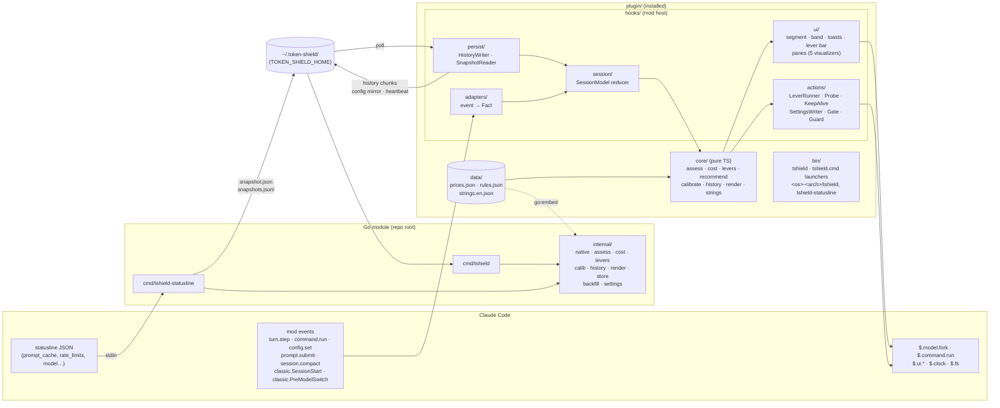
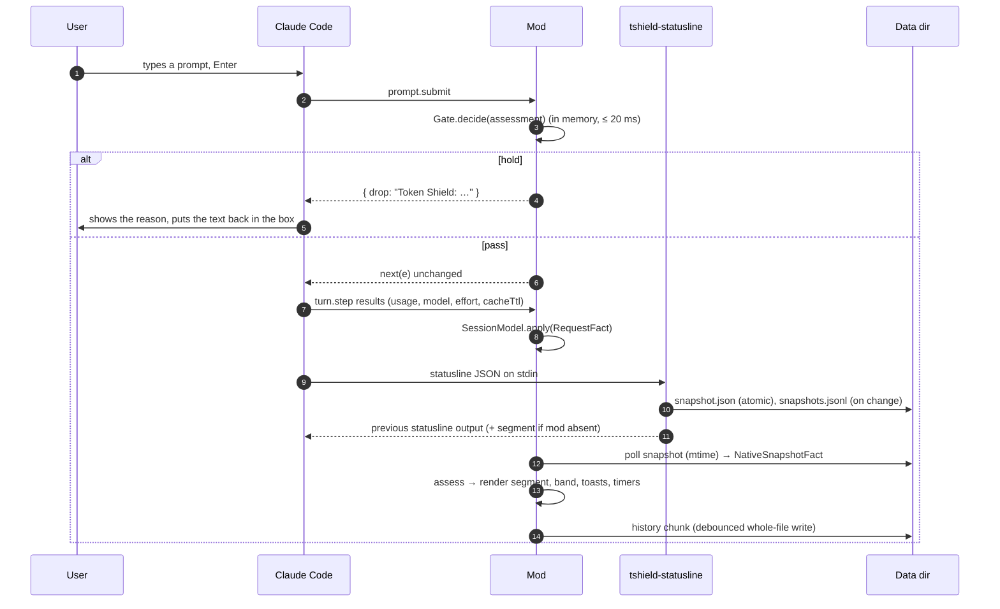
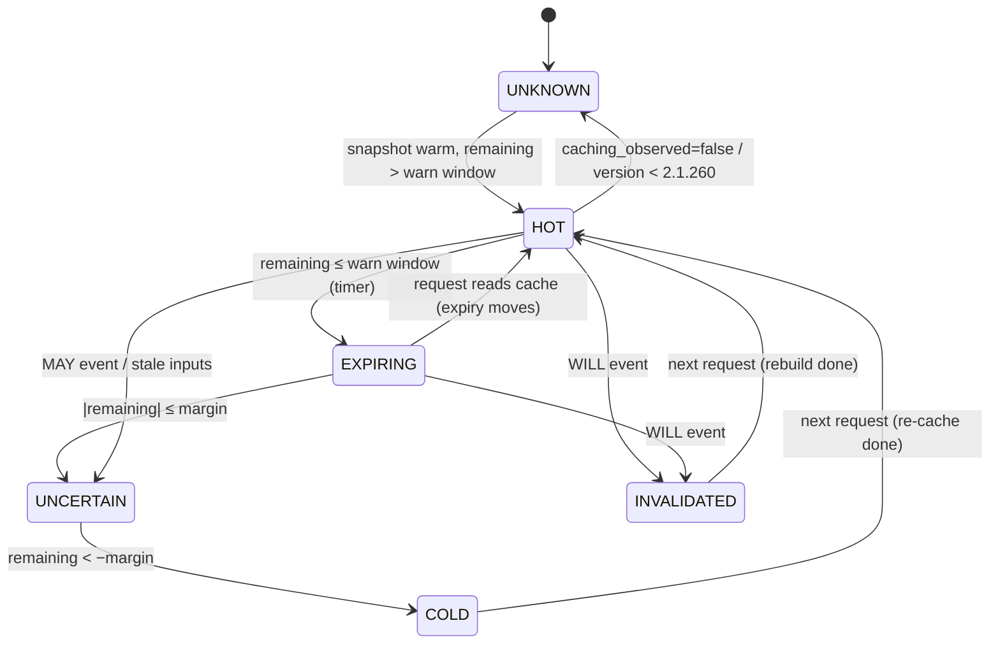
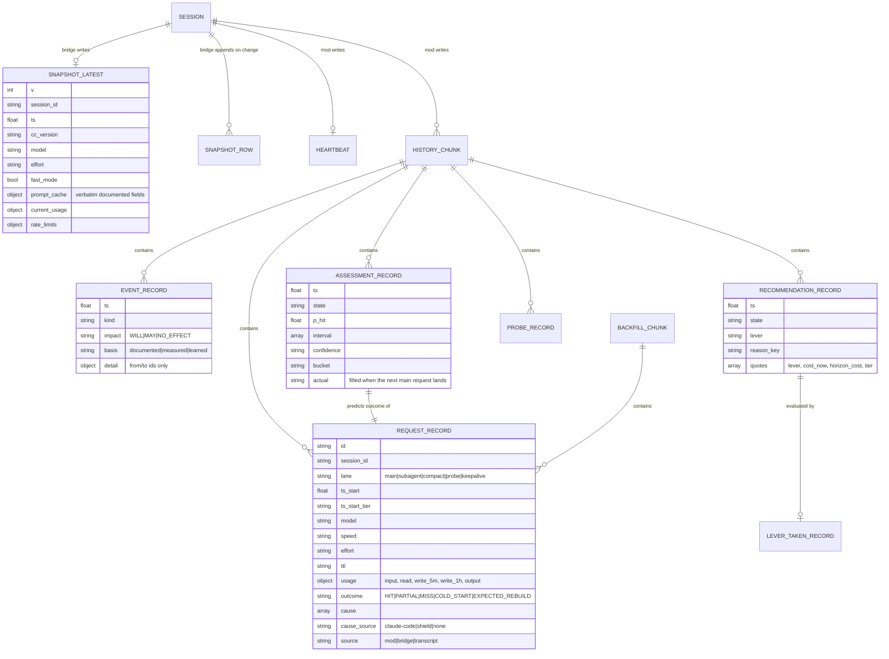

# Token Shield Design

## Summary

Token Shield has a pure TypeScript core that turns facts into an assessment, a price list of levers and a recommendation. Three thin hosts sit around it:

- **The mod** (`register.tsx`): adapts engine events into facts, draws every in-session surface, and runs levers with consent.
- **`tshield-statusline`** (Go): the bridge. It copies Claude Code's native `prompt_cache` data into a per-session snapshot file, passes the user's previous statusline through, and draws the segment itself when the mod is absent.
- **`tshield`** (Go): the CLI for checks, history, calibration, setup and backfill.

The Go side reimplements the parts of the core the CLI and statusline need. Shared JSON data (prices, invalidation rules, user-facing strings) and shared parity fixtures keep the two languages in step. All state is plain JSON in one data directory, and each file has exactly one writer. Nothing Token Shield draws enters a request to the model, and it runs only commands the user could type.

## Architecture

### Components



### Repository layout

```
.claude-plugin/marketplace.json     marketplace entry (points at the release branch)
plugin/                             the folder Claude Code installs
  .claude-plugin/plugin.json        manifest, userConfig, "types"
  hooks/hooks.json                  { "modules": ["./register.tsx"] }
  hooks/register.tsx                wiring only: on(...) → adapters/actions/ui
  hooks/adapters/                   engine event → Fact, one file per event family
  hooks/session/                    SessionModel (in-memory reducer, $.state atoms)
  hooks/actions/                    lever runner, gate, guard, probe, keep-alive, settings writer
  hooks/persist/                    snapshot reader, history writer, data-dir resolution
  hooks/ui/                         segment, band, toasts, lever bar, panes
  core/                             pure TypeScript: no engine globals, no I/O
  data/                             prices.json, rules.json, strings.en.json
  types/index.d.ts                  $.state contract
  bin/                              launchers + per-platform binaries (release branch only)
  test/                             claude plugin test suites (*.test.ts)
go.mod, embed.go                    Go module at the repo root; embed.go embeds plugin/data
cmd/tshield/, cmd/tshield-statusline/  Go entry points
internal/                           Go packages
fixtures/parity/                    shared cases: input → expected view model
fixtures/render/                    shared golden text for the segment and /cache-check
fixtures/sessions/                  synthetic statusline payloads and transcripts
schemas/                            JSON Schemas (check, history, snapshot, config)
.github/workflows/                  ci.yml, release.yml
```

The Go module sits at the repository root so that `embed.go` can embed `plugin/data/*.json` directly; `go:embed` cannot reach a parent folder.

### Data flow for one turn



### How the mod gets its inputs

| Need | Source in the mod | Notes |
|---|---|---|
| Native `prompt_cache`, `rate_limits`, `version`, `effort`, `fast_mode` | `snapshot.json` written by the bridge, polled by mtime every 5 s and on `turn.complete` | The only path to native cache state (tech.md, "Native-signal bridge") |
| Per-request usage, start time, model, effort, TTL, lane | `turn.step` result (`agentId` absent = main lane) | Fallback source of state when the bridge is missing |
| Model switch, before it happens | `classic.PreModelSwitch` (observe only: `next(e)` returned untouched) | Carries Claude Code's own `estimated_cache_write_usd` |
| Model switch, after | `classic.PostModelSwitch`, snapshot model change | `source: auto` covers fallback |
| Effort, fast mode, `/reload-plugins`, `/compact`, `/clear`, `/rewind`, `/recap`, `/btw` | `command.run` (observe only) and `config.set` (observe only) | Observed before the next request, so the guard can warn in time |
| Compaction | `session.compact` (observe; result `usage` prices the summarization) and `classic.PreCompact`/`PostCompact` | `agentId` set = subagent compaction, ignored for the main verdict |
| Resume and fork | `classic.SessionStart` with `source` `resume`/`fork` | `seconds_since_last_response`, `context_tokens`, `prompt_cache_likely_expired`, `estimated_cache_write_usd` |
| Session id, version, plugin root | `$.session.id()`, `$.session.version()`, `$.process.hookEnv()` (`CLAUDE_PLUGIN_ROOT`) | |
| Context composition | `$.session.usage({ breakdown: "summary" })` | Local estimate; no API call |

Every observing hook returns `next(e)` as received. No Token Shield hook returns `context`, `additionalContext`, a rewritten `text`, a `prompt.compose`/`prompt.section`/`tool.describe` answer, or a `permissionDecision` (REQ-5.0.4, REQ-10.0.3, REQ-20.0.1). The one exception is the opt-in switch confirmation (D10), which adds `permissionDecision: "ask"` and a reason to `classic.PreModelSwitch`'s result, never `allow` or `deny` (REQ-10.0.6).

## Key design decisions

### D1. Facts in, assessments out: one reducer, rebuilt on demand

Each adapter turns an engine event or a snapshot into a typed `Fact` (`NativeSnapshotFact`, `RequestFact`, `EnvEventFact`, `ResumeFact`, `ProbeFact`, …). `SessionModel` is a reducer, `(state, fact) → state`, that keeps the last snapshot, the main-lane request log (bounded to 200), and pending events since the last main request. `core.assess(state, now, params)` is a pure function of that state. The mod caches the latest assessment in memory and recomputes it when a fact arrives, a timer fires, or a render asks after more than 1 s.

*Why:* the same reducer and assessor run in Vitest, in `go test` (parity), in the backtest, and in the CLI over stored history. The submit gate reads the cached assessment, so it stays within REQ-21.0.2's 20 ms.
*Alternatives:* computing in each hook (untestable, duplicated); a long-lived daemon (excluded by tech.md's process model).

### D2. Native first, with a defined fallback chain

| Field | 1st | 2nd | 3rd |
|---|---|---|---|
| warm, expiry | `prompt_cache.warm`, `expires_at` [inferred by Claude Code] | last main `RequestFact.start + ttl` [inferred] | none → `UNKNOWN` |
| TTL | `prompt_cache.ttl` | `turn.step` `cacheTtl` | 5m/1h write split in usage |
| prefix tokens | `recache_tokens_if_cold` | `context_tokens` (hooks) | last request `input+read+write+output` |
| cost of a switch/resume | Claude Code's `estimated_cache_write_usd` | own cost model | — |

A missing or malformed field is never zero-filled. The fact records `absent`, and each derived figure inherits the lowest tier of its inputs (REQ-1.0.7). The bridge snapshot counts as stale after 60 s (REQ-2.0.9), so setup sets `statusLine.refreshInterval` low enough (target 30 s) that an idle session keeps a fresh snapshot. Without the bridge, the mod runs on the 2nd column, says "native data unavailable" in verbose output, and caps confidence at `MEDIUM`.

### D3. States, probability and confidence follow the analysis algorithm, encoded as data

The classifier is the analysis doc's §5/§6 algorithm. The changeable parts live in `data/rules.json`, versioned and shared with Go:

- the invalidation table (`event kind × model family × provider → WILL | MAY | NO_EFFECT`), including the per-message-effort model list;
- warn windows per TTL (defaults 10 min for 1h, 1 min for 5m);
- the timing constants (`skew` 5 s, base margin 10 s);
- the priors (`ε_within` 0.005, `ε_after` 0.01, Beta(1,1) for MAY events);
- the display caps (0.99 and 0.01).



The classification order is fixed:

1. `UNKNOWN`: unsupported version, `prompt_cache` absent, or `caching_observed = false`.
2. `INVALIDATED`: any pending WILL event.
3. `COLD`: `warm = false`, or `remaining < −margin`.
4. `UNCERTAIN`: `|remaining| ≤ margin`, any pending MAY event, or stale inputs.
5. `EXPIRING`: `remaining ≤ warn window`.
6. `HOT`: everything else.

Fixed precedence makes 2.1 ("that state and no other") testable as a total function.

Confidence is a separate output: `HIGH` when a documented rule decided the state from native or measured inputs; `MEDIUM` for learned probabilities, an inferred start time or drift; `LOW` for priors only, stale inputs or no bridge on a boundary decision. It never raises `p_hit`; it only labels it.

### D4. Cost model: one function, three units

`core.cost.nextTurn(prefix, model, ttl, provider, prices, at)` returns `{ warm, cold, penalty }` in tokens and in dollars. The dollar rates come from the price table entry in effect at `at`, with tiers applied by prefix size.

- `warm = prefix·in·read_mult + tail·in·write_mult(ttl)`, where `tail` is the last request's uncached plus newly written tokens (default 0 when unknown, tagged `[estimated]`).
- `cold = prefix·in·write_mult(ttl)`.

Output, tool loops and subagents are never included (REQ-3.0.7).

`core.billing.mode(snapshot)` picks how dollars are shown:

| Mode | Detected by | Shown |
|---|---|---|
| `subscription` | `rate_limits` present, main TTL 1h | tokens + plan share `[estimated]`; dollars only as "API-equivalent" in verbose output |
| `subscription-credits` | `rate_limits` present, main TTL 5m | tokens + plan share + dollars, labelled API-equivalent |
| `api` | no `rate_limits`, first-party model id | tokens + dollars, labelled API-equivalent |
| `provider` | Bedrock, Vertex or Foundry model id or env | tokens + dollars from the provider section, labelled provider-priced |

The billing mode itself is tagged `[inferred]`. Where Claude Code supplied `estimated_cache_write_usd` for the same action, that number replaces the dollar figure, labelled "Claude Code's estimate" (REQ-3.0.4).

### D5. Plan share: a learned percent-per-dollar ratio

The share of the 5-hour window can't be observed per turn (product.md, Open questions). `core.planshare` estimates it from the bridge's snapshot series:

1. Group consecutive snapshots by `rate_limits.five_hour.resets_at` (one window).
2. For each window, sum the API-equivalent dollars `D` of the main and subagent requests recorded between its first and last snapshot. Take `Δpct`, the change in `used_percentage`.
3. Per model family, keep `r = ΣΔpct / ΣD` over the last 14 days, with the number of windows `n`.
4. Plan share of a cost `c` is `r·c`, shown as "≈ 3% of 5-hour window [estimated]", with an interval from the spread of per-window ratios. With `n < 3` it shows "plan share: learning (n/3 windows)".

*Why:* integer percentages are too coarse per turn but accumulate usefully over a window. Without the bridge there is no `rate_limits`, and plan share is not shown (tech.md, Constraints).

### D6. Levers are a catalog of pure functions

`core.levers` holds one descriptor per lever: `id`, `kind` (`command` | `setting` | `spend` | `choice`), `applicable(state)`, `price(state, cost) → LeverQuote | unknown`, an effect on later turns, a certainty tier, a "when to use" string key, and the action.

| Lever | Cost now (first request) | Effect on later turns |
|---|---|---|
| continue | `expected = p·warm + (1−p)·cold` | prefix unchanged |
| `/compact [focus]` | summarization request (cold or warm read of the prefix plus output) + first request on the summary (write of `summaryTokens + system`) | prefix ≈ `system + summary`; summary size learned from history (default 8% of the prefix, `[estimated]`) |
| `/clear` (after `/rename`) | write of the system layer only | prefix ≈ system + new turn |
| `/rewind` | read of an earlier prefix still within TTL (from the request log), else unknown | prefix shrinks to that point |
| `/recap` | 0 cache cost (does not invalidate, does not shrink the prefix) | none; shown as "cache-safe, not cache-saving" |
| `/btw` | warm: small read; cold: listed with "cost unknown" | none (never enters history) |
| keep-alive | per refresh ≈ `warm` + a few output tokens × refreshes until the end time | keeps the cache warm |
| probe | quote `warm` and `cold` | refreshes expiry |
| TTL setting (main / subagent) | 0 now | from the TTL advisor's estimate |
| model / effort / fast choice | `cold` on the target model (Claude Code's estimate if given) | — |

`core.recommend(state, quotes)` applies a short ordered policy and returns exactly one lever, or `none`, with a reason key:

1. `HOT` with time left → `none` ("no action needed").
2. `EXPIRING` → continue now ("send before HH:MM").
3. `UNCERTAIN` → continue, mentioning `--probe` only when the probe's expected information outweighs its price, i.e. when the interval spans 0.2–0.8.
4. `COLD` / `INVALIDATED` → the minimum over continue, `/compact`, `/clear`-with-handoff and `/rewind` of `cost now + Σ(cost of the next H=5 turns)`, using the same quote model. Levers with unknown cost are excluded from the minimum (REQ-4.0.6). `/clear` throws away the conversation, a cost no price captures. So it is quoted and explained ("when you're changing tasks") but never recommended on cost alone.
5. `UNKNOWN` → `none`, plus what is missing.

Every recommendation is persisted with all quotes (REQ-4.0.7).

*Why:* a fixed policy is explainable in one line and easy to test, and the horizon term is what makes `/compact` comparable to continue (product.md, Open questions: "Judging good advice").

### D7. Display-only command output, with a mid-turn fallback

`/cache-check` answers `{ text, isTextDisplayOnly: true }` and never calls `next(e)` (nothing runs beneath it). The engine notes that a plugin's answer given while a turn is running may keep its text in requests. So while a main turn is running (between `turn.start` and `turn.complete`), the command returns an empty `text`, still display-only, and opens the same content in the Token Shield pane. AC 6.1 is tested in both cases.

The lever bar under the output is a display-only placed row (`$.ui.place`) holding Token Shield's buttons, because command text can't carry buttons (REQ-17.0.5).

### D8. Confirmation through Token Shield's own UI, not `$.ui.ask`

Probes, settings changes, keep-alive starts and the bridge setup are confirmed with Buttons in the above-prompt band ("confirm mode"), each labelled `Token Shield`.

*Why:* `$.ui.ask` runs as an `AskUserQuestion` tool call. Whether that reaches the transcript is not documented, and REQ-20.0.1 can't be risked on it. A band button is engine UI with no transcript row. It also keeps every Token Shield prompt visibly distinct from Claude Code's own (REQ-10.0.4).

### D9. The submit gate holds and remembers a hash only

In `prompt.submit`, the gate passes (`next(e)` untouched) when any of these is true:

- `e.command` is set, `e.isMeta` is set, or `e.origin` is not the user's composer;
- the gate is off (it shows a warning toast instead, REQ-12.0.4);
- the state is `UNKNOWN`, `HOT`, `EXPIRING` or `UNCERTAIN`;
- the cold cost is at or below the threshold.

Otherwise:

1. Hash the text (SHA-256, kept in memory only, never persisted).
2. If the same hash was held less than 60 s ago, pass `next(e)` untouched and clear the hold.
3. Else record `{hash, at}`, return `{ drop: "Token Shield: cache COLD … ≈ $6.50 · Enter again within 60 s to send, or /compact first" }`. Claude Code puts a dropped prompt back in the box itself, so Enter resends it unchanged; the gate does not call `$.prompt.fill`, which would double the text ([spikes.md](./spikes.md), §3).
4. Show the band with the recommended lever.

The gate never rewrites `text` or `context` (REQ-12.0.3). Any exception in the gate passes `next(e)` and logs the error (REQ-21.0.3).

### D10. Guard: information beside Claude Code's confirmation, and inside it only when asked

- **`classic.PreModelSwitch`** with `prompt_cache_warm = true`, at or above the threshold's info level: show a toast and the band in guard mode, each headed "Token Shield". They carry Claude Code's `estimated_cache_write_usd` and the cheaper alternative (run the one-off task in a subagent on the other model; or switch after a planned `/compact`). The hook returns `next(e)` unchanged, so Claude Code's own confirmation appears as normal (REQ-10.0.3).
  - *Timing:* Claude Code's confirmation covers the band and the status row while it is open, so the toast is the warning the user sees while deciding. It is shown with `timeoutMs: 30000` so it lasts through the decision; the band in guard mode is what remains once the dialog closes ([spikes.md](./spikes.md), §2).
  - *One event per switch:* the engine fires the event in pairs with different `to_model` values. The guard acts on the event whose `to_model` matches the request and ignores the rest of the burst. It stays silent when `to_model` equals `from_model` (§1).
  - *Clearing:* the band's guard mode and the status suffix end on `classic.PostModelSwitch`, on the next prompt submit, or when the snapshot shows the model did not change (no event fires on cancel).
- **Switch confirmation (opt-in, `switchConfirm: on`):** when the event is warm and the rebuild cost reaches the threshold, the hook returns `next(e)`'s result plus `permissionDecision: "ask"` and `permissionDecisionReason: "Token Shield: this switch rebuilds the cache (812k tokens), ≈ $6.50"`. Claude Code then shows its own confirmation with that text inside it, the picker included, and the switch goes ahead only on the user's yes (REQ-10.0.6). If a hook beneath already answered `deny`, that answer stands; the guard never answers `allow` or `deny`. The reason is engine UI, not transcript content; the AC 20.1 session runs with the option on to confirm it adds no tokens. The toast and band still show as above.
- **Effort and fast mode:** a `command.run` for `effort`/`fast` or a `config.set` on those rows, while warm, creates the pending event at once. If the rules give `WILL` for the current model and provider, the guard toasts the cost before the next request (REQ-10.0.2). Per-message-effort models give `NO_EFFECT` (AC 10.3).
- **`/reload-plugins`:** a `MAY` event (whether it changes tools depends on the plugin). This yields `UNCERTAIN` plus an info toast. Claude Code's own warning stays.
- In `COLD` or `INVALIDATED` the guard is silent (REQ-10.0.5).

### D11. Lever execution

`LeverRunner.run(id, args)`:

- **Command levers** call `$.command.run({ command, args })`, the same path as typing it (REQ-5.0.1, AC 5.1, 13.3, 17.1).
- **Setting levers** go to `SettingsWriter`. It shows the exact key, scope file and value, and on confirmation writes through `$.config.set` when a `/config` row exists. Otherwise it does a read-compare-write of the user settings JSON through `$.fs`, aborting if the file changed since it was shown. If writing is refused, it shows the JSON to paste (REQ-5.0.2).
- **Spend levers** (probe, keep-alive) need band confirmation (D8).

A failed command or write reports the failure in a toast and changes nothing else (REQ-5.0.5).

The compact and clear controls (REQ-17) are a single `LeverButton` component used in the lever bar, the band and the comparator pane:

- **Compact** runs at once.
- **Clear** has two states. A press arms it: the label becomes `CONFIRM?`, drawn inverse and bold, so it reads without color. A second press within 3 s runs `/clear`. A `$.clock.after(3000)` disarms it and restores the label. Arm state is a `$.state` atom keyed by button instance, so each surface arms independently, mirroring `session-info`.

The controls exist only in the main session's own surfaces; nothing is offered per subagent or for another session (REQ-17.0.4).

### D12. Probe and keep-alive through `$.model.fork`

**Probe.** `Probe.quote(state)` declines (unless `--force`) in two cases: `COLD`/`INVALIDATED` with `HIGH` confidence ("a probe would just pay the rebuild"), and `HOT` with more than 5 minutes left. Otherwise it shows both prices and the side effect in confirm mode. On confirmation it calls `$.model.fork({ prompt: "Reply with OK." })` with no `effort`, so the fork rides the session's level and reads the main entry. The result's `usage` is the measurement:

- `cache_read_input_tokens ≥ 0.95 × prefix` → `HIT`;
- `≤ 0.05 × prefix` → `MISS`;
- anything between → `PARTIAL`.

The new expiry is `now + ttl` `[inferred]`. A `nothing-to-fork` answer reports that no probe was possible (REQ-7.0.5). `tshield check --probe` never calls the API; it explains that the probe needs the mod (AC 7.4).

**Keep-alive.** `KeepAlive.start({ until, budgetUsd })` is created only from the user's own command or button (REQ-15.0.4), after confirm mode shows the estimated total (refreshes × warm cost). It schedules one `$.clock.after` at `expires_at − lead` (lead: 2 min on 1h, 30 s on 5m). Each tick:

1. If the user sent a prompt since the start, stop (REQ-15.0.3).
2. If `spent + quote.warm × 1.2 > budget`, stop with "budget reached" (the 1.2 factor guards against a refresh that costs more than quoted; AC 15.1).
3. Fork as the probe does, add the measured cost to `spent`, record a `ProbeFact` (lane `keepalive`), and schedule the next tick from the new expiry.

A `MISS` on a refresh stops the keep-alive: the cache was already lost, and refreshing would re-pay a rebuild. The band shows the spend so far while it runs.

### D13. Notifications: a small policy object over state transitions

`core.notify(prevState, nextState, now, policy)` returns zero or one notification. It fires on the transitions REQ-9.0.1 names and on a TTL change. A debounce of one per transition and one per 5 minutes applies, except at the critical level. Muted levels return nothing. Levels:

- **info:** → `COLD`, compaction done, resume warm;
- **warning:** → `EXPIRING`, → `UNCERTAIN`, TTL change, invalidating action while warm;
- **critical:** gate held, calibration drift.

The mod owns the timer. After each assessment it cancels and re-arms one `$.clock.after` at the next boundary (warn-window start, `expires_at − margin`, `expires_at + margin`), so `EXPIRING` and `COLD` appear on time in an idle session (REQ-9.0.5, AC 9.5).

### D14. The bridge stays tiny and wraps rather than replaces

`tshield-statusline`:

1. Reads stdin (≤ 1 MiB) and parses only the documented fields it needs into `NativeSnapshot`.
2. Writes `sessions/<id>/snapshot.json` atomically (temp file, then rename, retried on Windows sharing violations). It appends to `sessions/<id>/snapshots.jsonl` only when a tracked field changed (TTL, warm, model, effort, fast mode, version, miss count, rate-limit percentage).
3. Runs the previous command, if any, from `bridge.json`: through the platform shell, with the same stdin, a 300 ms timeout and output passed through byte for byte.
4. If `sessions/<id>/mod-heartbeat.json` is older than 90 s or absent, appends its own segment using the shared renderer and glyph set.

The p95 budget (50 ms) excludes the wrapped command's own time, which is the user's. Any failure in steps 1–2 or 4 still runs step 3 and exits 0 (REQ-21.0.3).

Setup (`/cache-check setup` or `tshield setup`):

- shows the current and the new `statusLine` value, and on confirmation saves the previous command into `bridge.json`;
- copies the binaries to `<data>/bin/` with `tshield self-install`, so the configured path survives plugin updates, which move the plugin folder;
- points `statusLine.command` at `<data>/bin/tshield-statusline` and sets `refreshInterval`.

`tshield setup --undo` restores the saved command.

### D15. Platform binaries and launchers

`bin/` holds `tshield` (a POSIX sh launcher), `tshield.cmd` (a Windows launcher) and `<os>-<arch>/tshield[.exe]` plus `tshield-statusline[.exe]` for six targets. The launchers pick the right binary, so `tshield` works from the Bash tool's PATH. The mod resolves its binary once per session by trying `<plugin root>/bin/<os>-<arch>/tshield version --json` candidates through `$.process.run`, and caches the one that answers. It then uses it for `self-install` and to resolve the data directory (`tshield paths --json`, which honors `TOKEN_SHIELD_HOME`). If no binary runs, the mod falls back to `CLAUDE_PLUGIN_DATA` for its own history, and the bridge and CLI features are reported unavailable.

### D16. History: per-session chunks written by the mod, calibration computed on read

The mod buffers history records in memory and flushes them with a debounce (on `turn.complete`, and every 30 s when dirty). A flush rewrites the open chunk `history/<session>/<seq>.json` whole. A chunk closes at 256 KiB or 500 records, and `seq` then increments. Records:

- `RequestRecord` (main and subagent lanes, with outcome and cause);
- `EventRecord`;
- `AssessmentRecord` (only the one that preceded each main request: the calibration pair);
- `RecommendationRecord` and `LeverTakenRecord`;
- `ProbeRecord`;
- `KeepAliveRecord`.

Calibration, avoidable spend, the TTL advisor and the advice report are **computed when read**, by the mod at session start (in the background, off the render path) and by `tshield`, from chunks inside the window. Nothing aggregate is stored, so no two writers ever share a file.

Retention removes session folders whose newest chunk is older than `historyDays` (default 90), on mod start and on `tshield prune`. `tshield forget` (and `/cache-check forget` after confirmation) deletes `history/`, `sessions/` and `backfill/` (REQ-14.0.9).

### D17. Baseline from transcripts, numbers only

`tshield backfill` (offered once after setup, run only on the user's yes) reads Claude Code transcript JSONL under the user's Claude config directory incrementally. It keeps a byte cursor per file in `backfill/cursor.json`. From each assistant message it extracts only the usage counts, timestamp, model, effort and version, and writes `backfill/<n>.json` request records with `source: transcript` and tier `[measured]` for counts, `[inferred]` for causes. Text fields are never read into a record. Fields are picked by key, and the parser discards message content before building a record (REQ-20.0.4).

The baseline is the avoidable spend per week before the install date (REQ-14.0.8). The format is internal to Claude Code, so a parse failure lowers the backfill's coverage and is reported. It never fails the command (REQ-21.0.4).

### D18. Hindsight evaluation of advice

`core.advice.evaluate(rec, laterRecords)`:

- **Taken lever:** the first lever action observed within 10 minutes after the recommendation, or before the next main request. A plain prompt counts as "continue". No action means the recommendation is not evaluated, except a `none` recommendation, which is evaluated against the next prompt.
- **Realized cost:** the measured cost of the taken path over the same horizon `H`. For `/compact` that includes the summarization request.
- **Alternatives:** re-priced with the realized cache outcome where it was observed, otherwise with the recorded `p_hit`.
- **Score:** the recommendation counts as "cheapest" when its hindsight cost is ≤ 1.05 × the minimum of the alternatives' hindsight costs.

The report shows the share of evaluated recommendations that were cheapest, with `n` (AC 14.5, product goal 3).

### D19. Calibration and drift

The bucket key is `state × ttl × remaining-time band` (bands: > 10 min, 1–10 min, ±margin, past). Each bucket reports n, the mean predicted `p_hit`, the observed hit rate, and a Wilson interval. The Brier score is reported overall and per Claude Code version × model × TTL (REQ-14.0.5).

Drift: when the `HOT` bucket's observed miss rate exceeds the upper bound of its stated interval with n ≥ 30, `core.calibrate` returns `drift: true`. The assessor then substitutes the observed rate's Wilson upper bound for `ε_within`, which widens every interval until the rate is back inside. The notification policy raises one critical toast per drift episode (AC 14.4).

### D20. Configuration

The source of truth is `userConfig` in `plugin.json`, edited in `/config`. On session start and on every `config.set` for its own keys, the mod validates each value against `core.config.schema`. An invalid value falls back to the default, and the mod shows one toast naming the setting (REQ-22.0.2). It then writes the effective values to `config.json` in the data directory for the companions.

| Key | Type | Default |
|---|---|---|
| `thresholdUsd` | number > 0 | 2 |
| `thresholdTokens` | integer > 0 | 250000 |
| `warnWindow1h` / `warnWindow5m` | duration | 10m / 1m |
| `gate` | `hold` \| `warn` \| `off` | `hold` |
| `switchConfirm` | `on` \| `off` | `off` |
| `mutedLevels` | subset of info, warning, critical | none |
| `glyphs` | `unicode` \| `ascii` | `unicode` |
| `keepAliveDefaultBudgetUsd` / `keepAliveDefaultMinutes` | number | 1 / 60 |
| `historyDays` | integer | 90 |
| `priceOverridesPath` | path | `<data>/prices.override.json` |

The threshold is reached when either the dollar value or the token value is exceeded. For subscription sessions only the token value applies.

## Data model

All files live under the data directory (`~/.token-shield/`, or `TOKEN_SHIELD_HOME`). Every record carries `v` (schema version). Readers ignore unknown fields and records with a newer major `v`.



| File | Writer | Format |
|---|---|---|
| `sessions/<id>/snapshot.json` | bridge | one `NativeSnapshot`, atomic replace |
| `sessions/<id>/snapshots.jsonl` | bridge | appended rows on change, capped at 2 MiB, then rotated to `.1` |
| `sessions/<id>/mod-heartbeat.json` | mod | `{ v, ts, pluginVersion }` every 30 s |
| `history/<id>/<seq>.json` | mod | `{ v, session_id, seq, records: [...] }` |
| `backfill/cursor.json`, `backfill/<n>.json` | `tshield backfill` (holds `backfill/.lock`) | cursor map; request records |
| `config.json` | mod | effective config |
| `prices.override.json` | the user | partial price table, merged over `plugin/data/prices.json` |
| `bridge.json` | setup (mod or `tshield`, holding `setup.lock`) | `{ previousCommand, installedAt, binVersion }` |
| `bin/` | `tshield self-install` | stable copies of the binaries |
| `logs/companions.log` | companions | capped 256 KiB, rotated |

**Privacy by construction (REQ-1.0.2, 20.0.4):** every record type above is a closed schema of numbers, timestamps, enums, model ids and cause names. The only free-text fields are ids. Adapters copy whitelisted fields; they never spread an event object into a record. The gate's prompt hash lives only in memory.

**Shared data files** (`plugin/data/`):

- `prices.json`: `{ v, effective: "2026-11-03", models: { id: { input, read_mult, write_5m_mult, write_1h_mult, tiers: [{ above, input }] } }, providers: { bedrock: {...}, vertex: {...}, foundry: {...} } }`, with older tables kept by date so costs use the table in effect on each request's date.
- `rules.json`: the invalidation table, warn windows, timing constants, priors and display caps.
- `strings.en.json`: every user-facing string by key, with placeholders. The renderers in both languages read only this catalog, so AC 2.8 is a check over one file: no future-tense string contains "hit" or "miss".

## Interfaces

### TypeScript core (`plugin/core/`)

```ts
/** Feeds one fact into the session model; pure, returns a new state. */
export function reduce(state: SessionState, fact: Fact): SessionState;

/** Classifies the main conversation's cache and attaches p_hit, interval, confidence and tier-tagged drivers. */
export function assess(state: SessionState, now: number, p: AssessParams): Assessment;

/** Prices the first request of the next turn warm and cold, in tokens and in the billing mode's units. */
export function nextTurnCost(input: CostInput, prices: PriceTable): NextTurnCost;

/** Quotes every lever applicable to the assessment. */
export function quoteLevers(a: Assessment, s: SessionState, ctx: LeverContext): LeverQuote[];

/** Picks exactly one lever or "none", with a reason key (D6). */
export function recommend(a: Assessment, quotes: LeverQuote[]): Recommendation;

/** Decides a submission: pass, warn or hold (D9). */
export function gateDecision(a: Assessment, cost: NextTurnCost, cfg: Config, held: HeldPrompt | null, hash: string, now: number): GateDecision;

/** Returns at most one notification for a transition (D13). */
export function notify(prev: Assessment | null, next: Assessment, log: NotifyLog, cfg: Config, now: number): Notification | null;

/** Builds the view model shared by /cache-check, the panes and tshield check. */
export function checkView(a: Assessment, quotes: LeverQuote[], rec: Recommendation, mode: CheckMode): CheckView;

/** Renders a view model as text at a width, in a glyph set; reads only the string catalog. */
export function renderCheck(view: CheckView, width: number, glyphs: GlyphSet, strings: Strings): string;
export function renderSegment(a: Assessment, cost: NextTurnCost, glyphs: GlyphSet, strings: Strings): string;

/** History aggregation and calibration over stored records. */
export function summarize(records: Iterable<HistoryRecord>, range: Range, filter: HistoryFilter): HistorySummary;
export function calibrate(pairs: Iterable<CalibrationPair>, prior: Priors): Calibration;
export function adviseTtl(records: Iterable<HistoryRecord>, prices: PriceTable): TtlAdvice;   // REQ-16
export function evaluateAdvice(recs: RecommendationRecord[], later: HistoryRecord[]): AdviceReport;
export function planShare(rows: SnapshotRow[], requests: RequestRecord[]): PlanShareModel;
```

`CheckView` is the contract for "same content" between surfaces (REQ-19.0.1). Its JSON form is published as `schemas/check.schema.json`, and `tshield check --json` emits it (AC 19.1).

### Mod surfaces

| Surface | Entry | Behavior |
|---|---|---|
| `/cache-check [--verbose\|--diff\|--probe [--force]\|history …\|setup\|keepalive …\|ttl\|forget]` | `command.run` matcher `{ command: 'cache-check' }` | Display-only text (D7) plus a placed lever bar |
| `/cache-view [map\|runway\|levers\|context\|history]` | `command.run` | Opens the Token Shield pane on a tab |
| Status segment | `$.ui.status(text)` after each assessment | Wall-clock expiry; no countdown (REQ-8.0.2) |
| Band | `ui.render` on `AbovePrompt` | Modes: `state` (EXPIRING/COLD/INVALIDATED), `guard`, `resume`, `confirm`, `keepalive`; hidden in HOT |
| Toasts | `$.ui.toast` via `core.notify` | Each prefixed "Token Shield" |
| Pane | `$.ui.open({ id: 'token-shield' })` + `ui.render` on `Pane` | Tabs: Prefix map · Runway · Levers · Context · History (+ TTL advisor section) |

### Visualizers (REQ-13)

All views are built from text cells with a glyph and a label for every colored element. They lay out at the width the surface reports and degrade to one column per bar at 80 columns.

- **Prefix map:** one row per recent main request. A bar is split into system+tools / project context / conversation (layer sizes from `$.session.usage` categories, then scaled by the request's token total). Each layer is patterned by read (`█`), written (`▓`) and uncached (`░`), with a legend. Rebuild rows carry the cause label (AC 13.1).
- **Runway:** a time axis from the last request to `expires_at + margin`, with `▲now`, the warn window as `[====]`, the expiry as `|` and `±margin` as `~`. Below it: "act before HH:MM ≈ $0.17 · after ≈ $6.50" (AC 13.2).
- **Levers:** a table of lever · cost now · effect later · tier · recommended `◆`, with a `LeverButton` per command lever (D11).
- **Context:** the categories from `$.session.usage({ breakdown: "summary" })` as horizontal bars, each marked `stable` (system, tools, project context, earlier conversation) or `changes each turn` (latest turn, tool results).
- **History:** re-cache spend by cause per day (stacked text bars whose segments sum to the total; AC 13.5), the idle-gap histogram against the TTL line, advice outcomes, and the reliability table.

### `tshield` CLI

```
tshield check [--verbose|--diff|--probe] [--session <id>] [--json]      exit 0/10/20/30/40/50
tshield history [--session <id>|--all] [--since 7d] [--misses] [--calibration] [--json]
tshield calibration [--json]
tshield ttl [--json]
tshield setup [--undo]      tshield self-install    tshield paths [--json]
tshield backfill            tshield prune           tshield forget [--yes]
tshield version [--json]
```

Without `--session`, `tshield check` picks the session with the newest snapshot. It assesses from the snapshot plus history, so it is exactly the mod's assessment minus events only the mod sees. Verbose output names that gap.

## Error handling & edge cases

| Case | Handling | Requirement |
|---|---|---|
| Any hook throws | Caught at the `register.tsx` boundary: observing hooks return `next(e)`, render hooks return `next(e)`, and the error goes to `$.ui.log` (debug log) once per error kind per session | 21.0.3, AC 21.3 |
| Claude Code < 2.1.260 | `UNKNOWN` with "requires Claude Code v2.1.260+"; gate, guard, toasts and probe disabled; `/cache-check` still answers | 1.0.4, AC 1.4 |
| No response yet | `UNKNOWN`, reason "no response received yet"; no percentage | 1.0.5, AC 1.5 |
| `caching_observed = false` | `UNKNOWN`, "prompt caching appears off or unreported", never `COLD` | 1.0.6, AC 1.6 |
| Snapshot older than 60 s | stale marker, confidence `LOW` | 2.0.9, AC 2.7 |
| Native vs own expiry differ by more than the margin | drift event; confidence ≤ `MEDIUM` | 2.0.10 |
| Bridge not configured or replaced by another tool | mod infers from `turn.step`; verbose says so; no plan share; a one-time info toast offers setup | tech.md risk |
| `statusLine` locked by managed settings | setup reports it and does not write | tech.md risk |
| Wrapped statusline command fails or times out | its stderr is dropped, nothing of its output is printed, the bridge's own segment still prints | 8.0.4 |
| TTL flips 1h → 5m mid-session | TTL-change event (once); the current entry keeps its expiry; the warn window switches with the next write | 1.0.3, AC 1.3 |
| Compaction | `EXPECTED_REBUILD`, not a miss; summarization priced from the `session.compact` usage | 2.0.4 |
| Subagent and fork requests | separate lanes; never in the main verdict or the headline cost; reported separately in history and the TTL advisor | 3.0.7, 16.0.1 |
| `/cache-check` while a turn runs | empty display-only text plus the pane (D7) | 6.0.5 |
| Two sessions in one directory | separate session folders; a shared-prefix hit is still reported as a hit, never credited to the session's own activity | — |
| Clock jump (sleep, hibernate) | timers re-armed on wake (a tick seeing `now` past the expected time re-assesses) | 9.0.5 |
| Resume with expired cache | band in resume mode before the first prompt: Claude Code's cold estimate, continue · `/compact` · `/clear` with handoff · `/recap` first; the gate also guards the first prompt | 11.0.1, AC 11.1 |
| Resume within TTL | segment "warm until HH:MM" (expiry from `seconds_since_last_response` and the session's last recorded TTL, `[inferred]`); no band, no warning | 11.0.2, AC 11.2 |
| Probe gets `nothing-to-fork` or an API error | report it; no calibration record; state unchanged | 7.0.5, 5.0.5 |
| Keep-alive refresh misses | stop; report the rebuild was already lost | 15.0.1 |
| Data directory unwritable | in-memory only for the session; one info toast; no surface blocked | 21.0.3 |
| Invalid config value | that key's default plus a toast naming it | 22.0.2, AC 22.2 |
| Price table has no entry for the model | costs "unknown" (tokens still shown); lever not recommended on cost | 4.0.6 |
| Network disabled | nothing changes: no component uses the network except Claude Code itself during an approved fork | 3.0.5, 20.0.3, AC 3.5 |
| Transcript format changes | backfill skips unparsable lines and reports coverage | 21.0.4 |
| History chunk unreadable or newer schema | skipped and counted in the history footer | — |

## Testing approach

| Layer | Tool | What |
|---|---|---|
| Core unit | Vitest + coverage-v8 | reducer, assessor (one fixture per state; precedence), cost (AC 3.1 numbers), levers, recommend, gate, notify, calibrate, advice, planshare, config validation, renderers at 80 and 120 columns in both glyph sets. Targets: critical modules (assess, cost, gate, recommend) ≥ 90% lines and branches; core overall ≥ 80% lines, ≥ 70% branches |
| Parity | Vitest + `go test` over `fixtures/parity/*.json` and `fixtures/render/*.txt` | identical `CheckView`, costs, exit-code mapping and segment text |
| Go unit | `go test -cover` | native parsing, atomic writes, wrap and timeout, self-install, backfill cursor, CLI flags. Target ≥ 80% statements |
| Mod behavior | `claude plugin test` | `/cache-check` display-only answer (incl. mid-turn), gate hold/resubmit/61 s (no `$.prompt.fill` call), switch confirmation adds `ask` only when on, warm and over the threshold, guard passes `next(e)` untouched, lever bar runs `$.command.run`, clear arm/disarm timing, notifications on transitions, invalid config toast, no forbidden hook registrations (AC 5.4 also by `claude plugin validate` and a grep in CI) |
| Benchmarks | `go test -bench` (bridge on a 1M-token-session payload); a timing harness around the gate hook | AC 21.1, 21.2 |
| Backtest | Go integration test over `fixtures/sessions/` | predicted vs actual outcome per request; reliability and Brier reported |
| Manual (walkthrough) | scripted session | AC 6.1/20.1 token-count comparison with and without Token Shield; AC 10.1 screenshot; AC 13.4 80-column monochrome screenshots; AC 15.3 90-minute keep-alive; AC 20.2 network monitor |

All fixtures are synthetic: real structure, every value replaced.

## Assumptions to confirm early

These engine behaviors were read from the 2.1.332 types before they were exercised. TASK-2 confirmed each one in a live session; the results, and the decisions taken from them, are in [spikes.md](./spikes.md).

| Assumption | Fallback |
|---|---|
| `classic.PreModelSwitch` / `classic.SessionStart` observed by a mod, with `next(e)` leaving Claude Code's confirmation intact | detect switches from `command.run`/`config.set` and the snapshot; resume from the first snapshot's gap |
| A toast or band is visible while Claude Code's model-switch confirmation is open | show the guard as a status-segment suffix, and in the band right after the dialog closes (before the next request) |
| `$.prompt.fill` after `{ drop }` puts the text back for a plain Enter | the drop reason says "press ↑ to recall it"; the 60 s identical-resubmit rule is unchanged |
| `statusLine.refreshInterval` keeps the bridge running while idle | the staleness rule uses "snapshot older than 60 s **and** older than the last main request or event", so an idle unchanged snapshot stays fresh |
| `$.process.run` children inherit the user's environment (`HOME`/`USERPROFILE`, `TOKEN_SHIELD_HOME`) | `tshield paths` falls back to the OS user-home lookup |
| A plugin's `command.run` answer mid-turn is the only case where display-only text can enter a request | D7 already covers it; the test in AC 6.1 confirms |

## Traceability

| Requirement | Design |
|---|---|
| REQ-1 Native signals | D2, D14; "How the mod gets its inputs"; edge-case rows for version, no response, caching off, TTL change (AC 1.1–1.7) |
| REQ-2 Assessment | D3 (states, precedence, confidence, caps), D19 (intervals), `strings.en.json` check (AC 2.8), tier tags in `renderCheck` verbose (AC 2.2), `rules.json` no-op rows (AC 2.3), stale and drift rows |
| REQ-3 Cost model | D4, D5, `prices.json`, override merge (AC 3.4), no network (AC 3.5), Claude Code estimate preference (AC 3.3) |
| REQ-4 Levers and recommendation | D6, `RecommendationRecord` (AC 4.5) |
| REQ-5 Execution with consent | D8, D11, D12; observe-only hooks (AC 5.4) |
| REQ-6 `/cache-check` | D7, `checkView`/`renderCheck`, mod surfaces table, `summarize` filters (AC 6.5) |
| REQ-7 Probe | D12; `tshield check --probe` refusal (AC 7.4) |
| REQ-8 Status segment | `renderSegment`, `$.ui.status`, D14 wrap (AC 8.3) |
| REQ-9 Notifications and band | D13, band modes |
| REQ-10 Guard | D10 (toast during the confirmation, band after it, opt-in switch confirmation), D8 labelling, D20 `switchConfirm` |
| REQ-11 Resume | `classic.SessionStart` adapter, band resume mode, edge-case rows |
| REQ-12 Gate | D9, default `gate: hold` (AC 12.5), threshold config (AC 22.1) |
| REQ-13 Visualizers | Visualizers section, `LeverButton` (AC 13.3) |
| REQ-14 History, calibration, advice | D16, D17, D18, D19 |
| REQ-15 Keep-alive | D12 |
| REQ-16 TTL advisor | `adviseTtl` (minimum 10 sessions with at least 20 idle gaps per bucket, else "not enough data"), `/cache-check ttl`, `tshield ttl` |
| REQ-17 Compact and clear controls | D11 `LeverButton`, lever bar and comparator |
| REQ-18 Statusline companion | D14, D15 |
| REQ-19 `tshield` | CLI interface, `CheckView` schema, exit codes |
| REQ-20 Privacy and context hygiene | D7, D8, D9, D16, D17; privacy by construction; observe-only hooks |
| REQ-21 Performance and robustness | D1 cached assessment, D14 budget, error boundary, CI on three OSes |
| REQ-22 Configuration | D20 |

Every acceptance criterion maps to a design element above. Six are verified manually rather than automatically (6.1 and 20.1 in a scripted live session, 10.1, 13.4, 15.3, 20.2); the testing table names each.

## Visual design application

Not applicable. No `design-system.md` or `art-bible.md` exists for this product, and the surfaces are engine-native terminal elements whose visual rules (glyph plus label, never color alone, 80-column minimum) come from REQ-13.0.6 and 13.0.7.
